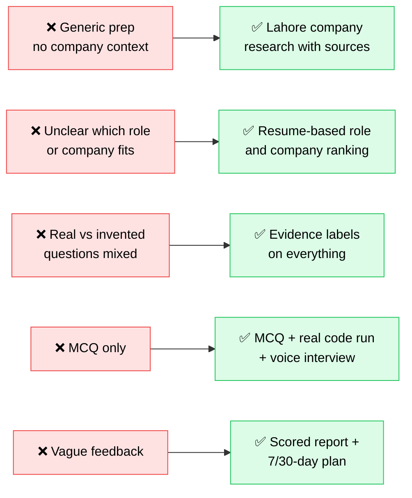
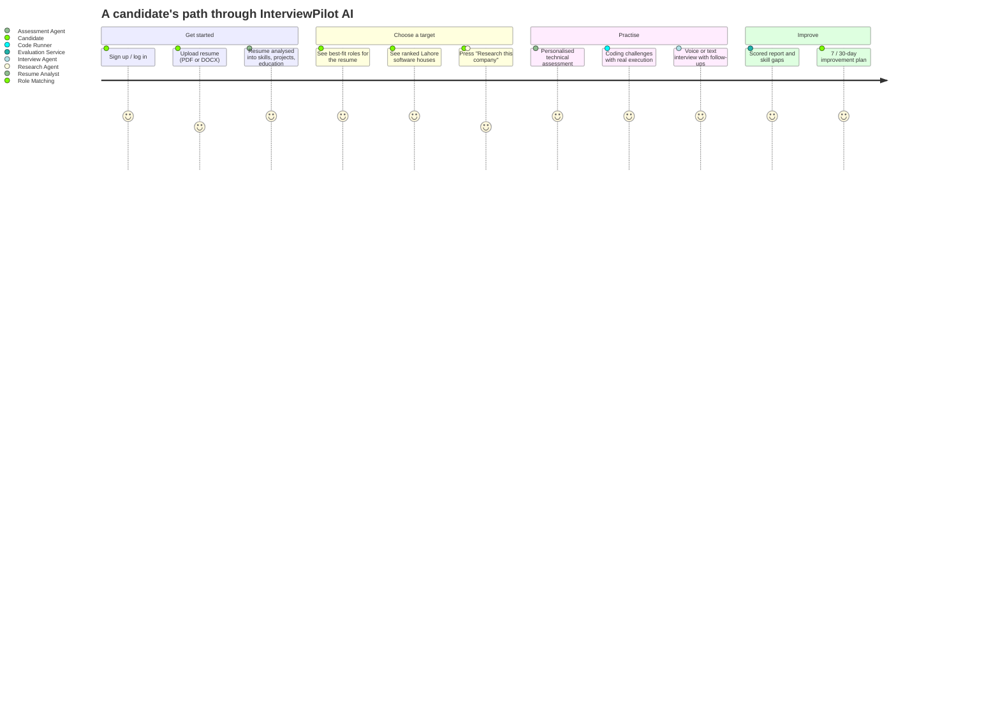
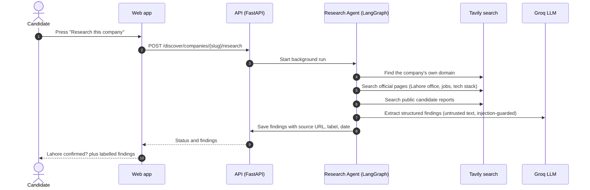
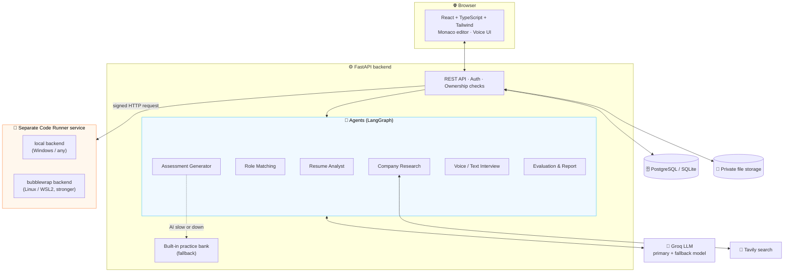

<div align="center">


<a href="https://github.com/">
  
</a>

<br/>


**[Quick start](#-quick-start-windows)** ·
**[Problem & solution](#-the-problem-and-our-solution)** ·
**[How it works](#-how-it-works)** ·
**[Architecture](#-architecture)** ·
**[Trust & honesty](#-trust-and-honesty-rules)** ·
**[Docs](#-documentation)**

</div>

---

## ✨ What is InterviewPilot AI?

InterviewPilot AI helps **students, fresh graduates, interns and junior developers** prepare for real opportunities at **software houses and startups that have a verified office in Lahore, Pakistan**.

You upload a resume, the platform suggests the roles and Lahore companies that fit it, a research agent looks at how a chosen company hires, and you practise with **personalised questions, a real code editor that actually runs your code, and a voice interview** — then receive a transparent, evidence-labelled report.

> **It is not a generic worldwide interview app, and it never pretends practice questions are real company questions.**

---

## 🎯 The problem and our solution

| 😖 The problem | ✅ How InterviewPilot AI solves it |
|---|---|
| Interview prep is **generic** (LeetCode lists, random blogs) and ignores the company you are applying to. | **Lahore-only company directory** plus a **Research Agent** that reads the company's own website and public hiring pages. |
| Students do not know **which roles and companies fit their resume** (a web developer and an AI/ML student need different targets). | **Resume Analyst + Role Matching** rank roles by fit, then suggest companies by focus area and skill overlap. |
| Prep sites mix real and invented content, so you cannot tell what is **actually reported** by candidates. | Every item carries an **evidence label** and a source link. Generated questions are always labelled *AI-generated practice*. |
| Most platforms only show **MCQs**. Real interviews include coding and a conversation. | **Technical assessment + Monaco code editor with real execution + voice/text interview** in one flow. |
| Feedback is vague ("study more"). | **Separate scores with a visible rubric**, a skill-gap list and a **prioritised 7- or 30-day plan**. |
| AI tools fail silently when the model is slow or rate-limited. | **Retries, fallback model and a built-in practice bank** so practice is never blocked, and the screen says when the bank was used. |



---

## 🧭 How it works



### 1. Resume → best-fit roles and companies
The resume is parsed into a validated schema (skills, projects, education, experience). Roles are scored against your skills, then Lahore companies are ranked by **focus area** (web, frontend, backend, mobile, AI/ML, data) and **skill overlap**.

| If your resume looks like… | You will mostly be pointed to… |
|---|---|
| React, JavaScript, CSS | Frontend / Full-Stack roles and web-focused houses |
| Python, SQL, REST APIs | Backend / Python roles and backend-focused houses |
| scikit-learn, PyTorch, pandas | AI/ML and Data roles and AI-focused houses/startups |
| Flutter, Dart | Mobile roles and mobile-focused houses |

> The match percentage is a **hint, not a prediction of being hired.**

### 2. Research Agent (per company)


A company is shown as **“Lahore presence confirmed”** only when a page on the company's **own website** mentions Lahore. That check is **automatic** and is labelled as such. Addresses are never invented.

### 3. Practice and report
| Stage | What you get | How it is scored |
|---|---|---|
| 📝 Technical assessment | About 20–30 MCQs, short answers and project questions | MCQs: objective. Short answers: rubric-based AI review |
| 💻 Coding | Monaco editor, visible + hidden tests, timer | **Objective** pass count from the runner (never from an LLM) |
| 🎙️ Voice / text interview | Resume- and role-based questions with follow-ups | Rubric-based AI evaluation, transcript only with consent |
| 📊 Report | Separate scores, strengths, gaps, practice questions | 7- or 30-day plan, progress over attempts |

---

## 🏷️ Trust and honesty rules

Every piece of content is labelled so you always know what you are looking at.

| Label | Meaning |
|---|---|
| 🟢 **Officially verified** | Supported by the company's official source |
| 🟡 **Public candidate report** | A public candidate experience; may be outdated and is not official |
| 🔵 **AI-generated practice** | Written for preparation; **never** claimed to be a real company question |
| ⚪ **Unverified / outdated** | Not enough evidence, or needs rechecking |

- Resume claims are **not** treated as verified facts.
- Web pages and resume text are treated as **untrusted data** (prompt-injection guarded).
- Scores are **preparation indicators**, not hiring decisions or guarantees.
- No covert surveillance; any integrity signal is transparent and best-effort.

---

## 🏗️ Architecture



**Key design choices**
- 🔒 User code is **never** executed inside the API process. It runs in a separate runner service; expected answers are never sent to the code that runs.
- 🛟 AI calls use short retries, a fallback model and a time budget. If the AI is still unavailable, a built-in practice bank fills the gap and the user is told.
- 🧩 Providers (LLM, search, runner) sit behind interfaces, so they can be replaced.

---

## 🚀 Quick start (Windows)

**You need:** Python 3.12+ and Node.js LTS (tick *“Add Python to PATH”* during install).

```text
1. Put your keys in apps\api\.env      (GROQ_API_KEY, LLM_MODEL_PRIMARY, TAVILY_API_KEY)
2. Double-click START.bat               (first run installs everything)
3. Open http://localhost:5173
```

`START.bat` will:
- create the Python environment and install packages (first run only),
- switch the code runner on in `.env` with a random secret (your other settings are kept),
- run database migrations and import the Lahore candidate list,
- open three windows: **Runner**, **API** and **Web**.

**Check it works:** open a coding problem. The banner should say *“Connected to the code runner (local)”*. Run the starter code (a test should fail), then a correct solution (all tests pass and a score appears).

> Full setup, WSL2 sandbox, tests, backup and troubleshooting: [`docs/SETUP_WINDOWS.md`](docs/SETUP_WINDOWS.md)

---

## 🧰 Feature checklist

| Area | Status |
|---|---|
| Sign-up, login, password change | ✅ |
| Lahore company directory (21 candidates, honest status) | ✅ |
| Resume upload (PDF/DOCX) and analysis | ✅ |
| Resume-based role and company suggestions | ✅ |
| Research Agent with source labels (user-run) | ✅ |
| AI practice assessments with built-in fallback bank | ✅ |
| Coding practice with real execution (Python) | ✅ |
| Voice and text interviews with feedback | ✅ |
| Scored reports, 7/30-day plan, progress tracking | ✅ |
| Data deletion and consent controls | ✅ |
| Verified on a real Windows machine | ⏳ please test and report |
| More coding languages | 🗓️ planned |

**Roles supported:** Python Developer · Backend Developer · Frontend Developer · Full-Stack Web Developer · Mobile App Developer · AI/ML Engineer Intern · Junior AI Engineer · Data Scientist

---

## 🛡️ Security at a glance

| Topic | Approach |
|---|---|
| Passwords & auth | Argon2 hashing, signed tokens, ownership checks on every user resource |
| Uploads | Type, size and content validation; private storage, no public URLs |
| Prompt injection | Resume and web text treated as untrusted; findings must be grounded in the source |
| Code execution | Separate runner service, one process per test, time/memory limits, hidden tests never sent to the browser |
| Secrets | Only in `.env` (git-ignored); `.env.example` has placeholders |

> ⚠️ **Runner note:** the default `local` backend is for practising on **your own machine**. It restricts time, memory and imports, but it is **not** a hardened sandbox. Do not expose port `8100`. For shared use, run the `bubblewrap` backend on Linux/WSL2.

---

## ✅ Testing

| Suite | Command | Last result |
|---|---|---|
| Backend | `cd apps/api && python -m pytest -q` | 524 passed, 78 skipped* |
| Frontend | `cd apps/web && npm run test` | 138 passed |
| Frontend quality | `npx tsc -b` · `npx eslint src` · `npx vite build` | clean |

\* The skipped tests are the Linux-only sandbox tests. They run in WSL2/Linux.
**Not yet verified:** real Windows run of `START.bat`, real browsers and microphone, and live Groq/Tavily calls.

---

## 🗂️ Project layout

```text
interviewpilot-ai/
├─ START.bat                 one-click start (runner + API + web)
├─ apps/
│  ├─ api/                   FastAPI backend, Alembic migrations, tests
│  └─ web/                   React frontend, component and route tests
├─ services/
│  └─ sandbox-runner/        separate code-runner service (local, bubblewrap, mock)
├─ data/                     company seed, role catalog, coding problem bank
├─ scripts/                  start and setup helpers
└─ docs/                     plan, decisions, contracts, rubrics, security, handover
```

---

## 📚 Documentation

| Document | Purpose |
|---|---|
| [`docs/SETUP_WINDOWS.md`](docs/SETUP_WINDOWS.md) | Step-by-step setup and troubleshooting |
| [`docs/KNOWN_ISSUES.md`](docs/KNOWN_ISSUES.md) | What is limited or unverified |
| [`docs/CHANGELOG.md`](docs/CHANGELOG.md) | What changed in each release |
| [`docs/COMPANY_DATA_POLICY.md`](docs/COMPANY_DATA_POLICY.md) | Lahore eligibility, verification and source labels |
| [`docs/SCORING_RUBRICS.md`](docs/SCORING_RUBRICS.md) | How each score is computed |
| [`docs/SECURITY_REVIEW.md`](docs/SECURITY_REVIEW.md) | Security review |
| [`docs/ARCHITECTURE.md`](docs/ARCHITECTURE.md) | Modules, data flows, agent boundaries |
| [`docs/HANDOVER.md`](docs/HANDOVER.md) · [`docs/NEXT_SESSION.md`](docs/NEXT_SESSION.md) | Continue the project in a new session |

---

## ⚖️ Disclaimer

InterviewPilot AI is a **preparation tool**. Scores and recommendations are **not** guarantees of selection or hiring and have no scientific validity claim. Company information can become outdated, so always check the linked sources. Practice questions are **AI-written** and are not questions asked by any company.

Never commit `.env`, uploaded resumes, databases or transcripts; `.gitignore` covers them.

<div align="center">


**Built for Lahore's next generation of engineers 🧡**

</div>