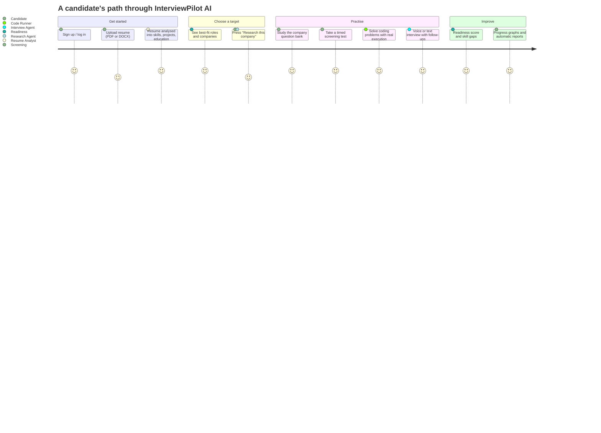
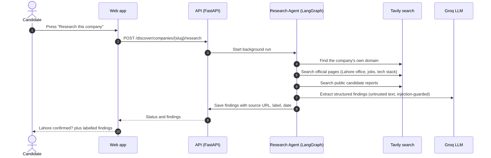
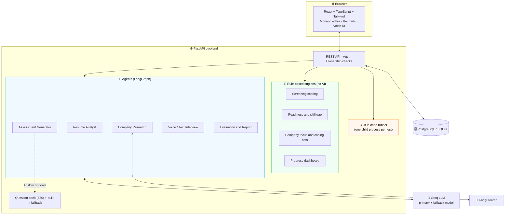

<div align="center">


<a href="https://github.com/">
  
</a>

<br/>


**[Quick start](#-quick-start-windows)** ·
**[Run in VS Code](#-run-it-from-the-vs-code-terminal)** ·
**[What is new](#-whats-new)** ·
**[How it works](#-how-it-works)** ·
**[Trust & honesty](#-trust-and-honesty-rules)** ·
**[Commands](#-command-cheat-sheet)** ·
**[Docs](#-documentation)**

</div>

---

## ✨ What is InterviewPilot AI?

InterviewPilot AI helps **students, fresh graduates, interns and junior developers** prepare for opportunities at **software houses and startups that have a verified office in Lahore, Pakistan**.

You upload a resume, the platform suggests the roles and Lahore companies that fit it, and you practise with:

- a **company-wise question bank** (525 technical and scenario questions, 25 for each of 21 software houses),
- **timed online screening tests** (105 MCQ and output questions),
- a **real code editor that really runs your code** and scores it by passed tests,
- a **voice / text interview**,
- and a **readiness report, skill-gap table and progress graphs** that show exactly how every number was calculated.

> **It is not a generic worldwide interview app, and it never pretends practice questions are real company questions.** No company publishes its interview questions, and this project has not verified any. All questions are labelled *company-focused practice*.

---

## 🆕 What's new

| Feature | What you get |
|---|---|
| ✅ **Coding submit and score fixed** | Code now runs on your computer through a built-in runner (`RUNNER_MODE=local`). No separate runner window. A submission is scored by tests passed, never by AI. |
| 🧩 **62 coding problems** | 25 easy, 27 medium, 10 hard. Strings, lists, tuples, dicts, sets, loops, conditions, stacks, linked lists, trees, two pointers, DP, graphs, backtracking. Every problem has hidden tests and wrong solutions that the tests must catch. |
| 🏢 **Company coding sets** | A fixed set of 25 problems per company (10 easy, 10 medium, 5 hard) chosen by the company's practice focus. Start a session from the set and skip problems you already solved. |
| 📚 **Question bank** | 525 technical and scenario questions (25 per company, 21 companies), each with an ideal answer, key points and follow-ups, and a visible **source label**. |
| ⏱️ **Online screening** | Timed MCQ and output tests. Output answers are computed by really running the code. Scored by fixed rules, with a deterministic next-step suggestion. |
| 🎯 **Company readiness** | Weighted score from skill match, role relevance, screening, assessment, coding and interview. Parts without data are **not assessed** and left out. Includes a skill-gap table, next actions, best-matching companies and roles. |
| 🧠 **Smart coding challenge** | Pick a role, a software house and a resume. Problems follow the company's focus and your resume skills, with a visible reason for each. |
| 📈 **My progress** | Graphs of coding scores, screening scores, topic strength, data-structure radar and report trend. Built only from your own saved work. |
| 🧾 **Automatic reports** | Finishing a coding session, an assessment or an interview saves a report to your history. No AI call, and it never uses your manual report quota. |
| 🛠️ **Manage questions (admin)** | Add, edit, enable/disable and delete questions, with the same validation as the import. |

---

## 🎯 The problem and our solution

| 😖 The problem | ✅ How InterviewPilot AI solves it |
|---|---|
| Interview prep is **generic** and ignores the company you are applying to. | **Lahore-only company directory**, a **Research Agent** with sources, and **company-focused** questions and coding sets. |
| Students do not know **which roles and companies fit their resume**. | **Resume Analyst, role matching and a readiness estimate** per company and role. |
| Prep sites mix real and invented content. | Every item carries an **evidence label**. Practice questions are always labelled as practice. |
| Most platforms only show **MCQs**. | **Screening tests + question bank + real code execution + voice interview** in one flow. |
| Feedback is vague ("study more"). | **Visible score breakdown**, skill gaps, deterministic next steps and progress graphs. |
| AI tools fail silently when the model is slow. | **Retries, fallback model and a built-in practice bank**. Scores that matter (coding, screening) never depend on AI. |

---

## 🧭 How it works



### How the readiness score is calculated

Role + optional company + resume. Only parts that have data are used. The weights of the others are scaled up to 100%.

| Part | Weight | Source |
|---|---:|---|
| Skill match | 15 | The role's required (counted twice) and preferred skills stated on your resume. Inferred skills count half. Skills tied to the company's focus count 1.5 times. |
| Role relevance | 10 | How much of the company's focus areas this role's skills cover (company chosen only). |
| Online screening | 20 | Average of your last 3 finished screening tests for the role. |
| Technical assessment | 15 | Your latest submitted assessment for the role (objective questions). |
| Coding | 25 | Tests passed in your latest finished coding session for the role (only code that really ran). |
| Technical interview | 15 | Your latest evaluated mock interview for the role. |

- With no result at all the label is **"Resume-based estimate only"** (or **"Not enough data"** without a resume).
- Labels: 75+ Strong match · 60+ Good match · 40+ Needs improvement · below 40 Low match.
- A skill is called *strong*, *improve* or *weak* only after you answered questions on it. Otherwise it is shown as **stated on resume, not assessed**.
- This is a **preparation estimate, not a hiring probability.**

### Research Agent (per company)



A company is shown as **"Lahore presence confirmed"** only when a page on the company's **own website** mentions Lahore. Addresses are never invented.

---

## 🏷️ Trust and honesty rules

| Label | Meaning |
|---|---|
| 🟢 **Verified** | Supported by a reliable, identifiable source (a source note is required) |
| 🟡 **Reported** | Shared by a candidate or community, not independently verified (a source note is required) |
| 🔵 **Company-focused practice** | Written for the company's technology focus. **Never** claimed to be a real company question |
| ⚪ **Unverified / outdated** | Not enough evidence, or needs rechecking |

- Company "focus" comes from this project's own rough notes (`data/company_seed`, `data/company_focus`). It is **not** verified information about what any company asks.
- Company coding sets are chosen from the shared 62-problem bank, so problems are shared between companies.
- Resume claims are **not** treated as verified facts. Resume text and web pages are **untrusted data** (prompt-injection guarded).
- Scores are **preparation indicators**, not hiring decisions or guarantees.
- Coding runs in **Python only**. SQL is covered by screening questions, not coding problems.

---

## 🏗️ Architecture



**Key design choices**
- 🔒 User code is **never** executed inside the API process. The built-in runner starts a **fresh child Python process per test**. Hidden tests and expected answers are never sent to the browser or to the code that runs.
- 🧮 Scores that matter (coding, screening, readiness) are calculated by **fixed rules**. AI is used to explain and to evaluate free-text answers, not to invent scores.
- 🛟 AI calls use short retries, a fallback model and a time budget. If the AI is unavailable, the built-in bank fills the gap and the user is told.
- 🧩 Providers (LLM, search, runner) sit behind interfaces, so they can be replaced.

---

## 🚀 Quick start (Windows)

**You need:** Python 3.12+ and Node.js LTS (tick *"Add Python to PATH"* during install).

```text
1. Put your keys in apps\api\.env      (GROQ_API_KEY, LLM_MODEL_PRIMARY, TAVILY_API_KEY)  -- optional
2. Double-click START.bat               (first run installs everything)
3. Open http://localhost:5173
```

`START.bat` will:
- create the Python environment and install packages (first run only),
- set `RUNNER_MODE=local` in `.env` (code runs on your computer inside the API),
- run database migrations (latest is `0011`),
- import the Lahore companies, **62 coding problems** and **630 questions**,
- open **two windows**: **API** (port 8000) and **Web** (port 5173).

The browser does **not** open by itself. Open **http://localhost:5173** yourself. Keep both windows open while you use the app. Close them to stop.

**Check it works:** open a coding problem, run the starter code (a test should fail), then a correct solution (tests pass and a score appears). Then press **Finish session** and look at **My progress**.

> Full setup, tests, backup and troubleshooting: [`docs/SETUP_WINDOWS.md`](docs/SETUP_WINDOWS.md)

---

## 💻 Run it from the VS Code terminal

Open the project folder in VS Code and use **two terminals** (`` Ctrl+` `` opens the first, the `+` button opens another).

### One-time setup (also after every update of the project files)

```powershell
cd F:\interviewpilot-ai
apps\api\.venv\Scripts\python scripts\prepare_env.py
cd apps\api
.\.venv\Scripts\python -m alembic upgrade head
.\.venv\Scripts\python -m app.cli import-seed
.\.venv\Scripts\python -m app.cli import-problems
.\.venv\Scripts\python -m app.cli import-questions
```

If the Python environment does not exist yet:

```powershell
cd F:\interviewpilot-ai
python -m venv apps\api\.venv
apps\api\.venv\Scripts\python -m pip install -r apps\api\requirements.txt
cd apps\web
npm install
```

### Terminal 1 — backend (API)

```powershell
cd F:\interviewpilot-ai\apps\api
$env:RUNNER_MODE="local"
.\.venv\Scripts\python -m uvicorn app.main:app --port 8000
```

Ready when you see `Uvicorn running on http://127.0.0.1:8000`.

### Terminal 2 — frontend

```powershell
cd F:\interviewpilot-ai\apps\web
npm run dev
```

Ready when you see `Local: http://localhost:5173`. Open it in the browser.

> Stop either server with `Ctrl+C`. If port 8000 or 5173 is busy, close the older server windows first (for example the ones opened by `START.bat`).

---

## 🧾 Command cheat sheet

| What | Command (run from the folder shown) |
|---|---|
| Make yourself admin (to see **Manage questions**) | `cd apps\api` then `.\.venv\Scripts\python -m app.cli make-admin you@example.com` |
| Check that the code runner works | `cd F:\interviewpilot-ai` then `apps\api\.venv\Scripts\python scripts\check_runner.py` |
| Re-import questions after editing the data files | `cd apps\api` then `.\.venv\Scripts\python -m app.cli import-questions` |
| Re-import coding problems | `cd apps\api` then `.\.venv\Scripts\python -m app.cli import-problems` |
| Apply database migrations | `cd apps\api` then `.\.venv\Scripts\python -m alembic upgrade head` |
| Rebuild technical questions from `scripts\qb_*.py` | `python scripts\build_question_bank.py` |
| Rebuild screening questions (answers are computed by running code) | `python scripts\build_screening.py` |
| Rebuild coding problems | `python scripts\build_coding_problems.py` |
| Backend tests | `cd apps\api` then `.\.venv\Scripts\python -m pytest -q` |
| Frontend tests | `cd apps\web` then `npm run test` |
| Frontend type check and lint | `cd apps\web` then `npx tsc -b` and `npx eslint .` |

> Update the project files in place? **Back up `apps\api\.env` and the `.db` file first**, extract the new files over the old ones, put the backup back, then run the one-time setup above (or just double-click `START.bat`).

---

## 🧰 Feature checklist

| Area | Status |
|---|---|
| Sign-up, login, password change | ✅ |
| Lahore company directory (21 candidates, honest status) | ✅ |
| Resume upload (PDF/DOCX) and analysis | ✅ |
| Resume-based role and company suggestions | ✅ |
| Research Agent with source labels (user-run) | ✅ |
| AI practice assessments with built-in fallback bank | ✅ |
| **Company question bank: 25 questions for each of 21 companies (525)** | ✅ |
| **Source labels on every question; admin screen to manage questions** | ✅ |
| **Online screening: 105 timed MCQ and output questions, rule-based scoring** | ✅ |
| **Coding practice with real execution (Python), 62 problems** | ✅ |
| **Company coding sets: 25 problems per company (10 easy, 10 medium, 5 hard)** | ✅ shared bank |
| **Smart coding challenge by company and resume** | ✅ |
| **Company readiness, skill gap, role and company match tables** | ✅ |
| **Progress dashboard with graphs; automatic reports in history** | ✅ |
| Voice and text interviews with feedback | ✅ |
| Data deletion and consent controls | ✅ |
| 25 problems that are unique to each company | ⏳ not done (bank is shared) |
| Question bank inside the AI mock interview | ⏳ not done |
| Screening and readiness inside the automatic report | ⏳ not done |
| QA Engineer and Data Engineer roles | ⏳ not done |
| Verified on a real Windows machine | ⏳ please test and report |
| More coding languages (JavaScript, Java, ...) | 🗓️ planned |

**Roles supported:** Python Developer · Backend Developer · Frontend Developer · Full-Stack Web Developer · Mobile App Developer · AI/ML Engineer Intern · Junior AI Engineer · Data Scientist

**Companies (21):** Arbisoft · Systems Limited · NETSOL Technologies · Tkxel · 10Pearls · CureMD · Folio3 · Devsinc · PureLogics · Nextbridge · NorthBay · Conrad Labs · Mindstorm Studios · Xeven Solutions · Afiniti · Confiz · Cubix · Techlogix · Contour Software · Kualitatem · vTeams

---

## 📊 Content at a glance

| Content | Where | Count |
|---|---|---|
| Technical and scenario questions | `data/questions/<company>.json` | 525 (25 for each of 21 companies, easy/medium/hard mix) |
| Screening MCQ and output questions | `data/questions/screening/screening.json` | 105 |
| Coding problems with hidden tests | `data/coding/problems.json` | 62 (25 easy, 27 medium, 10 hard) |
| Company coding sets | computed, not stored | 25 per company (10/10/5) |
| Company focus notes | `data/company_seed/`, `data/company_focus/` | 21 companies |

**Add a question:** sign in as an admin, open **Manage questions**, press **Add question**. Or add an object to `data/questions/<company>.json` and run `import-questions`.
**Add a company:** add `slug`, `name`, `tech_focus` to `data/company_seed/lahore_candidates.json`, run `import-seed`, then add `data/questions/<slug>.json`.
**Add a role:** add `slug`, `title`, `required`, `preferred`, `family` to `data/roles/roles.json`.

More detail: [`docs/QUESTION_BANK_AND_READINESS.md`](docs/QUESTION_BANK_AND_READINESS.md)

---

## 🛡️ Security at a glance

| Topic | Approach |
|---|---|
| Passwords and auth | Argon2 hashing, signed tokens, ownership checks on every user resource |
| Admin | Admin-only endpoints and screens, audit log for question changes |
| Uploads | Type, size and content validation; private storage, no public URLs |
| Prompt injection | Resume and web text treated as untrusted; findings must be grounded in the source |
| Code execution | A fresh child process per test, time and memory limits, hidden tests never sent to the browser |
| Secrets | Only in `.env` (git-ignored); `.env.example` has placeholders |

> ⚠️ **Runner note:** the default `local` runner is for practising on **your own machine**. It restricts time, memory and imports, but it is **not** a hardened sandbox. Do not expose the API to the public internet with it. For shared use, run the separate `bubblewrap` runner (`RUNNER_MODE=http`) on Linux/WSL2.

---

## ✅ Testing

| Suite | Command | Last result |
|---|---|---|
| Backend | `cd apps/api && python -m pytest -q` | 773 passed, 287 skipped* |
| Frontend | `cd apps/web && npm run test` | 148 passed |
| Frontend quality | `npx tsc -b` · `npx eslint .` · `npx vite build` | clean |

\* The skipped tests are the Linux-only sandbox tests. They run in WSL2/Linux.
These results come from a Linux machine. **Not yet verified:** a real Windows run of `START.bat`, real browsers and microphone, and live Groq/Tavily calls.

If coding says the runner is not connected, run `scripts\check_runner.py` (see the cheat sheet) and read the message it prints.

---

## 🗂️ Project layout

```text
interviewpilot-ai/
├─ START.bat                 one-click start (API + web)
├─ apps/
│  ├─ api/                   FastAPI backend, Alembic migrations (0001-0011), tests
│  │  └─ app/                coding · questions · screening · readiness · reports · resumes · interviews · ...
│  └─ web/                   React frontend, pages, charts, component and route tests
├─ services/
│  └─ sandbox-runner/        code runner (local backend is built into the API; bubblewrap backend optional)
├─ data/
│  ├─ questions/             company question files + screening/
│  ├─ coding/                coding problem bank
│  ├─ company_seed/          21 Lahore candidate companies
│  ├─ company_focus/         focus notes used for company-focused practice
│  └─ roles/                 role catalog
├─ scripts/                  setup helpers, check_runner.py, question and problem builders (qb_*.py, screening_*.py, problems_*.py)
└─ docs/                     plan, decisions, rubrics, security, question bank and readiness, changelog
```

---

## 📚 Documentation

| Document | Purpose |
|---|---|
| [`docs/SETUP_WINDOWS.md`](docs/SETUP_WINDOWS.md) | Step-by-step setup and troubleshooting |
| [`docs/QUESTION_BANK_AND_READINESS.md`](docs/QUESTION_BANK_AND_READINESS.md) | Question bank, screening, coding sets, readiness calculation, how to extend |
| [`docs/KNOWN_ISSUES.md`](docs/KNOWN_ISSUES.md) | What is limited or unverified |
| [`docs/CHANGELOG.md`](docs/CHANGELOG.md) | What changed in each release |
| [`docs/COMPANY_DATA_POLICY.md`](docs/COMPANY_DATA_POLICY.md) | Lahore eligibility, verification and source labels |
| [`docs/SCORING_RUBRICS.md`](docs/SCORING_RUBRICS.md) | How each score is computed |
| [`docs/SECURITY_REVIEW.md`](docs/SECURITY_REVIEW.md) | Security review |
| [`docs/ARCHITECTURE.md`](docs/ARCHITECTURE.md) | Modules, data flows, agent boundaries |
| [`docs/HANDOVER.md`](docs/HANDOVER.md) · [`docs/NEXT_SESSION.md`](docs/NEXT_SESSION.md) | Continue the project in a new session |

---

## ⚖️ Disclaimer

InterviewPilot AI is a **preparation tool**. Scores, readiness estimates and recommendations are **not** guarantees of selection or hiring and have no scientific validity claim. Company information can become outdated, so always check the linked sources. Practice questions are **written for practice** and are not questions asked by any company.

Never commit `.env`, uploaded resumes, databases or transcripts; `.gitignore` covers them.

<div align="center">


**Built for Lahore's next generation of engineers 🧡**

</div>